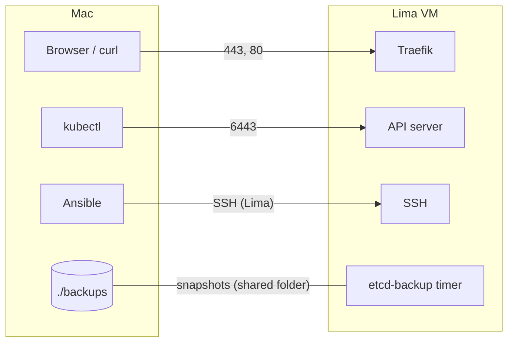
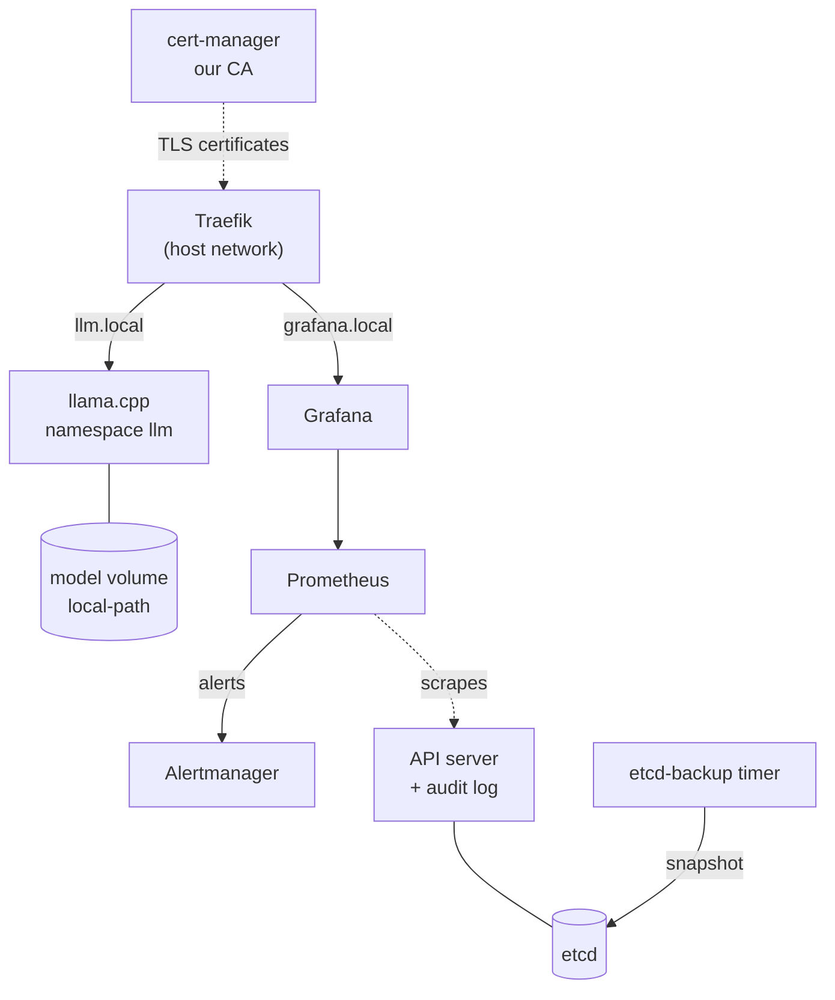

# Architecture

## How the Mac reaches the VM

Lima runs the VM (Debian 13 arm64, 4 CPU, 8 GiB, 40 GiB) and forwards only ports 443, 80 and 6443 ([ports](#ports)), plus its own SSH port.
Ansible runs on the Mac and connects over SSH. Exact versions: [versions](versions.md).
With your own VM (`external-vm.conf`) the picture is the same, but an SSH tunnel replaces Lima's forwards and the
snapshots are pulled instead of shared. That VM may be air-gapped: its downloads then go through the Mac over SSH,
to an allowlist only ([install guide](install.md#internet-access-from-the-vm)).

## Inside the cluster

Pods talk over Calico's network. App pods start with "deny all" NetworkPolicies ([who may talk to the app](#who-may-talk-to-the-app)).

## Stack

| Part | Choice | Why |
|---|---|---|
| VM | Lima, Debian 13 arm64 | [ADR 0001](decisions/0001-lima-vm.md) |
| Container runtime, installer | containerd, kubeadm | set by the assignment |
| Network plugin (CNI) | Calico | [ADR 0002](decisions/0002-calico-cni.md) |
| Ingress | Traefik | [ADR 0003](decisions/0003-traefik-ingress.md) |
| Storage | local-path-provisioner | [ADR 0004](decisions/0004-local-path-storage.md) |
| TLS | our own root CA + cert-manager | [ADR 0005](decisions/0005-internal-ca-and-renewal.md) |
| Backups | etcd snapshots to `./backups` on the Mac | [ADR 0006](decisions/0006-etcd-backups-outside-cluster.md) |
| Pod security | Pod Security Admission `restricted` | [ADR 0007](decisions/0007-pod-security-restricted.md) |
| Sample app | llama.cpp + Qwen2.5-0.5B, model kept on a volume | [ADR 0008](decisions/0008-model-caching.md) |
| Monitoring | kube-prometheus-stack | [ADR 0010](decisions/0010-monitoring-stack.md) |
| Read-only user | client certificate + ClusterRole | [ADR 0011](decisions/0011-operator-identity.md) |
| Host tools | pinned copies in `.tools/` | [ADR 0012](decisions/0012-host-toolchain.md) |
| Agent permissions | a guardrail, not a security boundary | [ADR 0009](decisions/0009-agent-permissions-guardrail.md) |

## Provisioning order

`ansible/site.yml` runs these roles in order. Each role has a tag with the same name.

| # | Role | Namespaces | Requirement |
|---|---|---|---|
| 1 | `os_prep` | — | 1 |
| 2 | `containerd` | — | 1 |
| 3 | `kubeadm` | kube-system | 2, 8c |
| 4 | `cni_calico` | tigera-operator, calico-system | 3a |
| 5 | `storage` | local-path-storage | 5 |
| 6 | `pki` | cert-manager (root CA made on the Mac) | 4 |
| 7 | `ingress_traefik` | traefik; also creates `llm`, `monitoring`, `ingress-check` | 4 |
| 8 | `monitoring` | monitoring, node-exporter | 6 |
| 9 | `etcd_backup` | — (systemd timer on the node) | 7 |
| 10 | `hardening` | — (cluster RBAC) | 8a |
| 11 | `llm_app` | llm | 9, 3b, 8b |

## Ports

The Mac reaches the VM only through ports that Lima forwards.

| Mac | VM | What |
|---|---|---|
| 443 | 8443 | Traefik HTTPS |
| 80 | 8000 | Traefik HTTP, redirects to HTTPS |
| 6443 | 6443 | Kubernetes API |

Prometheus scrapes these on the node IP (not forwarded): API server 6443, kubelet 10250, etcd 2381,
controller-manager 10257, scheduler 10259, kube-proxy 10249, node-exporter 9100, Traefik 9101.

## Who may talk to the app

Namespace `llm` starts with "deny all" NetworkPolicies for traffic in and out. Then:

| From | To | Port | Allowed |
|---|---|---|---|
| Node IP (Traefik runs on the host network) | llama.cpp | 8080/TCP | yes |
| Model download Job (`component=model-fetch`) | DNS, public IPs | 53, 443 | yes, only while it runs |
| Anything else | — | — | no |

The llama.cpp pod itself has no outbound access. Why: [ADR 0003](decisions/0003-traefik-ingress.md),
[ADR 0008](decisions/0008-model-caching.md).

## Control plane notes

Set by the `kubeadm` role:
- Pod network `10.244.0.0/16`, because Lima uses `192.168.5.0/24`.
- systemd cgroups.
- The API certificate also covers `127.0.0.1` and `localhost`, so `out/admin.conf` works through the Lima forward.
- Metrics ports of controller-manager, scheduler, kube-proxy and etcd listen on the node IP, so Prometheus can reach them.
  etcd also keeps `127.0.0.1:2381` first, for its health probe.
- Cluster CA, front-proxy CA, etcd CA and ServiceAccount key pair are saved to `.secrets/kubeadm-pki/` after the first
  `kubeadm init` and put back before `init` on a rebuilt VM, so the cluster keeps its trust roots
  ([ADR 0006](decisions/0006-etcd-backups-outside-cluster.md#restore-on-a-rebuilt-vm)).
- kubeadm reads its config only on the first `kubeadm init`. Later changes need `make vm-reset`.
  The audit policy and Pod Security config are re-read when the API server restarts (the role handles that).
